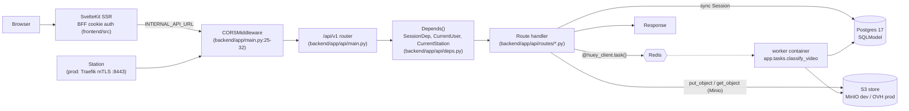

# CLAUDE.md

## What this is

**PerchPub** is a self-hosted bird-feeder observation server. Raspberry Pi stations capture photos/short videos at a feeder and POST them here over mTLS; the backend stores the media in S3, runs TensorFlow Lite classification in a background worker, persists observations, and serves them to a SvelteKit SSR web UI on the same domain (browser → BFF → API). The end-to-end ingest path — enrollment, upload, classification, browsing — is wired up ([README.md](README.md)); **ActivityPub republishing is the main capability still to come.** Built on the Full Stack FastAPI Template.

## Request flow

No lifespan/startup handlers ([backend/app/main.py](backend/app/main.py)); Sentry does init at import when `SENTRY_DSN` is set outside `local` ([backend/app/main.py:14-15](backend/app/main.py#L14-L15)). DB sessions are per-request via `SessionDep`. Module-import side-effects to know about: `app.tasks` constructs the Huey Redis client and the S3 Minio client unconditionally at import ([backend/app/tasks.py:40-52](backend/app/tasks.py#L40-L52)) — both connect lazily, so import doesn't touch the network, but a misconfigured endpoint can still surface as `ConfigurationError`. The TF Lite interpreter is loaded lazily on first task via `_get_classifier()` ([backend/app/tasks.py:98-99](backend/app/tasks.py#L98-L99), `lru_cache`) so the worker pays its cost on the first classification, not at boot. The API container builds two more module-level Minio clients: [backend/app/api/routes/uploads.py:20-26](backend/app/api/routes/uploads.py#L20-L26) and [backend/app/api/routes/media.py:13-19](backend/app/api/routes/media.py#L13-L19).

## Layout

- [backend/app/main.py](backend/app/main.py) — `FastAPI()` + CORS (+ Sentry init outside `local`).
- [backend/app/api/main.py](backend/app/api/main.py) — aggregates routers under `/api/v1`; `private` router is gated to `ENVIRONMENT=="local"`.
- [backend/app/api/routes/](backend/app/api/routes/) — one module per resource: `users`, `login`, `stations`, `observations`, `species`, `uploads`, `media`, `classify_tasks`, `enrollment`, `utils`, `private`.
- [backend/app/api/deps.py](backend/app/api/deps.py) — `SessionDep`, `CurrentUser`, `OptionalCurrentUser`, `CurrentStation` (mTLS), `get_current_active_superuser`, audit-provenance helpers.
- [backend/app/models/](backend/app/models/) — SQLModel tables + their Pydantic schema siblings.
- [backend/app/core/](backend/app/core/) — `config.py` (pydantic-settings), `db.py` (engine), `security.py` (JWT, bcrypt), `ratelimit.py` (Redis fixed-window, fail-open), `quotas.py` (DB-backed enrollment/station ceilings, advisory-locked).
- [backend/app/ca/step_ca_client.py](backend/app/ca/step_ca_client.py) — step-ca JWK-provisioner client (signs device CSRs via one-time tokens during enrollment).
- [backend/app/tasks.py](backend/app/tasks.py) — Huey jobs: `classify_video` + nightly `purge_enrollment_audit`.
- [backend/app/alembic/](backend/app/alembic/) — migrations; `env.py` reads `SQLModel.metadata`.
- [backend/app/crud.py](backend/app/crud.py), [backend/app/utils.py](backend/app/utils.py) — helpers (user CRUD, email, reset tokens).
- [backend/tests/](backend/tests/) — pytest: `api/routes`, `crud`, `ca`, `scripts`, plus [backend/tests/integration/](backend/tests/integration/) (compose-backed worker / step-ca / smoke tests driven by `scripts/integration-test.sh`).
- [frontend/src/routes/](frontend/src/routes/) — SvelteKit routes: `(public)` observations / species / stations / signup, `(app)` dashboard / stations / enroll / admin / account (auth-guarded), `media/[...path]` proxy, `login` / `logout`.
- [frontend/src/lib/](frontend/src/lib/) — domain helpers + `api/` (typed client: generated `schema.d.ts` + openapi-fetch; regen with [frontend/scripts/generate-client.sh](frontend/scripts/generate-client.sh)) + `server/` (BFF cookie auth/session) + `components/`.
- [frontend/e2e/](frontend/e2e/) — Playwright suites (compose `playwright` service or `npm run test:e2e`).
- [classification/](classification/) — dev seed model + labels; `minio-init` uploads them into the dev bucket on every `up`.

Pattern: **layered / template-shaped** — routes → `crud` or inline queries → SQLModel. No repository or service abstractions.

## Conventions

**Models vs schemas.** Each resource file in `backend/app/models/<name>.py` defines both the table class and Pydantic variants with these suffixes:
- `XxxBase` — shared fields
- `XxxCreate` — POST body
- `XxxUpdate` — PATCH/PUT body (fields optional)
- `XxxPublic` — response (adds `id`)
- `XxxsPublic` — list response, shape `{data: [...], count: int}`

Register new table classes in [backend/app/models/__init__.py](backend/app/models/__init__.py) so Alembic autogenerate sees them.

**Routers.** One per resource. Declare `router = APIRouter(prefix="/<name>", tags=["<name>"])`, then register in [backend/app/api/main.py](backend/app/api/main.py). OpenAPI operation IDs are generated as `{tag}-{name}` via [backend/app/main.py:10-11](backend/app/main.py#L10-L11).

**Auth.** Users: OAuth2PasswordBearer pointing at `/api/v1/login/access-token`; JWT HS256 signed with `settings.SECRET_KEY` ([backend/app/api/deps.py:24-30](backend/app/api/deps.py#L24-L30), [backend/app/core/security.py](backend/app/core/security.py)). Add `current_user: CurrentUser` to require a user, `OptionalCurrentUser` for public routes that enrich when logged in, `Depends(get_current_active_superuser)` for admin-only. Auth-failure 401s are deliberately generic so the BFF treats any 401 as "clear the cookie". Passwords hashed with bcrypt via passlib. Stations: `CurrentStation` ([backend/app/api/deps.py:139-218](backend/app/api/deps.py#L139-L218)) parses the Traefik-forwarded mTLS leaf (`MTLS_CLIENT_CERT_HEADER`), verifies it against the device CA, and resolves identity by SHA-256(SPKI) pin **alone** — CN/SANs are never trusted; missing header, bad cert, unknown or revoked pin all collapse to the same generic 401.

**DB access.** Inject `session: SessionDep` ([backend/app/api/deps.py:33-38](backend/app/api/deps.py#L33-L38)). Sessions are **synchronous** `sqlmodel.Session`; commits are explicit. Default to `def` handlers. Only use `async def` when you actually `await` something (e.g., [backend/app/api/routes/uploads.py](backend/app/api/routes/uploads.py) reads an `UploadFile`).

**Errors.** Raise `fastapi.HTTPException(status_code, detail)`. No custom exception handlers, no error-envelope model — the default `{"detail": "..."}` shape is canonical.

**Migrations.** From inside `backend/` (or `docker compose exec backend`): `alembic revision --autogenerate -m "..."` then `alembic upgrade head`. `env.py` uses `target_metadata = SQLModel.metadata` ([backend/app/alembic/env.py:24](backend/app/alembic/env.py#L24)).

**Settings.** Everything runtime-configurable lives in [backend/app/core/config.py](backend/app/core/config.py). Add the field there, then expose in `.env.dev` / `.env.prod`. Secrets that must not stay at placeholder get a `_check_default_secret("changethis")` guard (see `POSTGRES_PASSWORD`/`FIRST_SUPERUSER_PASSWORD`); secrets that must not stay **empty** get `_check_required_secret` (raises in `staging`/`production`, warns in `local` — see `SECRET_KEY`, `ENROLLMENT_HMAC_KEY_HEX`).

**Object storage.** Minio client (not boto3) against an S3-compatible endpoint; the env vars keep their historical `GARAGE_*` names. Dev runs an **in-stack MinIO** (`minio` + `minio-init` in [docker-compose.override.yml](docker-compose.override.yml); Hetzner is decommissioned) — ephemeral, so the bucket and the classifier model/labels are re-seeded from [classification/](classification/) on every `up`. Prod targets OVH Object Storage. Bucket = `settings.GARAGE_BUCKET_NAME`. Upload key convention is `<h[:2]>/<h[2:4]>/<h><ext>` where `h = sha256(bytes)` ([backend/app/api/routes/uploads.py:52-54](backend/app/api/routes/uploads.py#L52-L54)). The SigV4 signature region is configurable via `settings.GARAGE_REGION` (default `"garage"` preserves dev/test behaviour; OVH prod sets `gra` — lowercase, distinct from the uppercase `GRA` OVH API region); all three module-level `garage_client` instances ([uploads.py](backend/app/api/routes/uploads.py), [media.py](backend/app/api/routes/media.py), [tasks.py](backend/app/tasks.py)) read it. `GET /media/{object_name}` streams objects through the API with immutable cache headers — media is public in P0, and the future visibility check has a marked seam in [media.py](backend/app/api/routes/media.py).

**Background work.** Huey on Redis. Decorate with `@huey_client.task()` (or `periodic_task(crontab(...))`) in [backend/app/tasks.py](backend/app/tasks.py); the `worker` docker-compose service runs `huey_consumer`. Current jobs: `classify_video` and the nightly `purge_enrollment_audit` (03:17, D3 retention). Do **not** use FastAPI `BackgroundTasks` for anything that needs the TF Lite model — only the worker loads it. The enrollment rate limiter ([backend/app/core/ratelimit.py](backend/app/core/ratelimit.py)) reuses the same Redis.

## Executing an OpenSpec change

Changes live in [openspec/changes/](openspec/changes/) (`schema: spec-driven`): `proposal.md` + `design.md` + `tasks.md` + per-capability spec deltas (`### Requirement:` SHALL → `#### Scenario:` WHEN/THEN), archived to [openspec/changes/archive/](openspec/changes/archive/) once shipped (canonical specs accrete under [openspec/specs/](openspec/specs/)).

**`tasks.md` is the plan — do not generate a second one** (no `writing-plans`). Build a change with the superpowers execution disciplines, not by naively checking off tasks:

1. **TDD off the scenarios.** Each `#### Scenario` (WHEN/THEN) in the change's spec deltas is an acceptance test — write it as a failing Playwright/pytest test *first*, then implement the task that makes it pass (`test-driven-development`).
2. **One change in flight, phases in order.** Work `tasks.md` top to bottom.
3. **Verify before claiming done** (`verification-before-completion`): run the suite and show the output — frontend `npm run lint && npm run check && npm run test` + Playwright; backend `bash scripts/lint.sh && bash scripts/test.sh` when the change touches `backend/`; and `openspec validate <change-id> --strict`. A checked box is not evidence.
4. **Review, then archive** — `requesting-code-review` before merge; archiving folds the deltas into [openspec/specs/](openspec/specs/).
5. Use `systematic-debugging` for failures and `subagent-driven-development` to parallelize independent sibling tasks.

**Nothing is currently in flight** — all nine shipped changes (frontend rewrite P0–P3, enrollment QR, enrollment hardening, station-setup streamlining, …) live in [openspec/changes/archive/](openspec/changes/archive/), and the accreted capability specs under [openspec/specs/](openspec/specs/) are the source of truth. The frontend architecture of record is the archived P0 design ([openspec/changes/archive/2026-06-30-add-sveltekit-frontend-foundation/design.md](openspec/changes/archive/2026-06-30-add-sveltekit-frontend-foundation/design.md)) plus [openspec/specs/web-frontend/spec.md](openspec/specs/web-frontend/spec.md). The next headline capability is **ActivityPub publishing** — start it as a new change (proposal → design → tasks), not by coding directly.

## Gotchas

1. **No env file is auto-loaded by `Settings`.** [backend/app/core/config.py:26-29](backend/app/core/config.py#L26-L29). Every consumer must inject env explicitly: `docker compose --env-file .env.dev …` for dev, `docker compose --env-file .env.prod -f docker-compose.yml -f docker-compose.prod.yml …` for prod (`--env-file` covers both compose-parse-time `${VAR}` substitution and the per-service `env_file:` injection — single source of truth per environment, FU-15; the prod overlay `docker-compose.prod.yml` adds the in-stack Traefik edge + block-volume binds). Host-dev: `set -a && . ../.env.dev && set +a` before `fastapi dev`; `bash scripts/test.sh` sources `../.env.dev` itself when present.
2. **`SECRET_KEY` has no usable default.** [backend/app/core/config.py:31](backend/app/core/config.py#L31) is `SECRET_KEY: str = ""`; `_check_required_secret` raises in `staging`/`production` and warns in `local`. Always set it explicitly — empty value silently invalidates JWTs across workers in dev.
3. **Private routes only mount when `ENVIRONMENT=local`.** [backend/app/api/main.py:32-33](backend/app/api/main.py#L32-L33). Useful when debugging 404s across environments. WI-11 layered superuser + `X-Perchpub-Debug-Key` (`settings.DEBUG_KEY`) checks on top of the local-only mount, so empty `DEBUG_KEY` keeps the routes effectively dark.
4. **Tests force `POSTGRES_DB=app_test` at conftest import (FU-16 hardening).** [backend/tests/conftest.py:1-7](backend/tests/conftest.py#L1-L7) mutates the environment **before** any `app.*` module loads, so any pytest invocation — direct or via `scripts/test.sh` — runs against the dedicated test DB. Side-effect: importing `tests.conftest` from a non-pytest context (e.g. an ad-hoc REPL) also mutates the caller's `POSTGRES_DB`. Run via `bash scripts/tests-start.sh` for the canonical setup (DB creation + alembic + pytest).
5. **`CurrentStation` trusts a forwarded header.** Station identity arrives as base64 DER in `X-Forwarded-Tls-Client-Cert` ([backend/app/api/deps.py:139-218](backend/app/api/deps.py#L139-L218)) and is only trustworthy behind the prod Traefik mTLS entrypoint, which rewrites the header from the verified handshake. Anything that can reach `backend:8000` directly can impersonate a station by stuffing it — dev runs no proxy (FU-11), and tests exploit exactly that on purpose. Never publish the backend port in prod.

## Commands

Run from the repo root unless noted. "(backend/)" means `cd backend` or `docker compose exec backend`. Every `docker compose` invocation needs `--env-file .env.dev` (dev) or `--env-file .env.prod -f docker-compose.yml -f docker-compose.prod.yml` (prod) — set `COMPOSE_ENV_FILES=.env.dev` in your shell or alias `dc='docker compose --env-file .env.dev'` to avoid repeating the flag.

| Task | Command |
| --- | --- |
| Start full stack (dev, with file-sync) | `docker compose --env-file .env.dev watch` |
| Tail backend logs | `docker compose --env-file .env.dev logs -f backend` |
| Backend only, host Python | `cd backend && uv sync && set -a && . ../.env.dev && set +a && fastapi dev app/main.py` |
| Frontend dev | `cd frontend && npm run dev` |
| Frontend lint + typecheck | `cd frontend && npm run lint && npm run check` |
| Frontend tests (vitest + Playwright e2e) | `cd frontend && npm run test` (e2e only: `npm run test:e2e`) |
| Regenerate typed API client | `bash frontend/scripts/generate-client.sh` |
| Tests (host) | `cd backend && bash scripts/test.sh` |
| Tests (stack) | `docker compose --env-file .env.dev exec backend bash scripts/tests-start.sh` |
| Integration tests (compose-backed worker/step-ca) | `bash backend/scripts/integration-test.sh` |
| Lint (mypy + ruff check + ruff format --check) | `cd backend && bash scripts/lint.sh` |
| Format | `cd backend && bash scripts/format.sh` |
| Typecheck only | `cd backend && uv run mypy app` |
| Install pre-commit hooks (prek) | `uv run prek install -f` |
| Run hooks on all files | `uv run prek run --all-files` |
| New migration | `docker compose --env-file .env.dev exec backend alembic revision --autogenerate -m "msg"` |
| Apply migrations | `docker compose --env-file .env.dev exec backend alembic upgrade head` |
| Seed first superuser | `docker compose --env-file .env.dev exec backend python app/initial_data.py` |
| Generate `SECRET_KEY` | `python -c "import secrets; print(secrets.token_urlsafe(32))"` |

Dev ports (from [docker-compose.override.yml](docker-compose.override.yml)): backend `:8000`, frontend `:5173`, adminer `:8080`, mailcatcher UI `:1080` / SMTP `:1025`, step-ca `:9000`, postgres `:5432`, redis `:6379`, MinIO S3 `:9102` / console `:9103`, Playwright report `:9323`; the integration-test overlay ([docker-compose.test.yml](docker-compose.test.yml)) maps its own MinIO to `:9100/:9101` and Postgres to `:5433` so a dev stack and an integration run can coexist. No Traefik in dev (FU-11) — devs and tests hit services directly on these ports; prod runs an **in-stack Traefik edge** ([docker-compose.prod.yml](docker-compose.prod.yml)) terminating HTTPS (Let's Encrypt) on `:443` and enforcing station mTLS on `:8443` for the station-facing routes `/api/v1/upload/` (POST media), `/api/v1/classify-task/` (poll the result), and `/api/v1/enrollment/renew` (unattended cert renewal) (dynamic config in [deploy/traefik/dynamic/dynamic.yml](deploy/traefik/dynamic/dynamic.yml)) — the prod stack is provisioned by Terraform per [deploy/terraform/README.md](deploy/terraform/README.md) / [deployment.md](deployment.md). The frontend is the **SvelteKit SSR app** (`@sveltejs/adapter-node`, container port `:3000`) served on the **apex `Host(${DOMAIN})`** (with a `www`→apex redirect) in prod; dev runs it as the Vite dev server on `:5173` (`npm run dev`). The browser is same-origin — server-side `load`/form-actions reach the backend via `INTERNAL_API_URL` (`http://backend:8000`); the old nginx-static image and `VITE_API_URL` build arg are gone (P0 frontend rewrite).

Required env vars to boot (no defaults in [backend/app/core/config.py](backend/app/core/config.py)): `PROJECT_NAME`, `POSTGRES_SERVER`, `POSTGRES_USER`, `FIRST_SUPERUSER`, `FIRST_SUPERUSER_PASSWORD`. Practically also: `SECRET_KEY`, `POSTGRES_PASSWORD`, `POSTGRES_DB`, `GARAGE_ENDPOINT` + `GARAGE_KEY_ID` + `GARAGE_SECRET` + `GARAGE_BUCKET_NAME`, `HUEY_REDIS_HOST`, `ENROLLMENT_HMAC_KEY_HEX`. See [.env.dev](.env.dev) for working dev values.

## Open questions

- No open design questions. Loose ends as of 2026-07-22:
  - **ActivityPub publishing** is the last unbuilt headline capability — no module under `backend/app/` exists for it yet; start it as an OpenSpec change.
  - `dev/replace-tf-with-litert` (swap TensorFlow for LiteRT to cut CI runner disk) is unmerged and ~82 commits behind `main` — rebase or redo before landing.
  - **No live prod deployment has ever run** — the Terraform / Traefik / OVH story is fully in-tree ([deployment.md](deployment.md)) but has not been stood up.
  - The Codeberg branch `origin/dev/complete-mtls-authentication` is a dead leftover, safe to delete.
