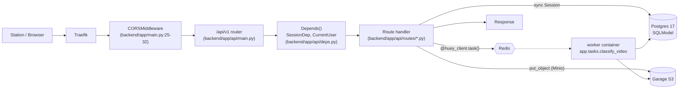

# CLAUDE.md

## What this is

**PerchPub** is a self-hosted bird-feeder observation server. Raspberry Pi stations capture photos/short videos at a feeder and POST them here; the backend stores the media, runs TensorFlow Lite classification in a background worker, persists observations, and (eventually) republishes them via ActivityPub. The HTTP API is consumed by the stations and by a frontend web UI served under the same Traefik domain. The project is early-stage (see [README.md](README.md): "nothing works yet") and built on the Full Stack FastAPI Template.

## Request flow

No lifespan/startup handlers ([backend/app/main.py](backend/app/main.py)). DB sessions are per-request via `SessionDep`. Module-import side-effects to know about: `app.tasks` constructs the Huey Redis client and the Garage Minio client unconditionally at import ([backend/app/tasks.py:37-49](backend/app/tasks.py#L37-L49)) — both connect lazily, so import doesn't touch the network, but a misconfigured endpoint can still surface as `ConfigurationError`. The TF Lite interpreter is loaded lazily on first task via `_get_classifier()` ([backend/app/tasks.py:65-93](backend/app/tasks.py#L65-L93)) so the worker pays its cost on the first classification, not at boot. The API container also builds its own Minio client at module level in [backend/app/api/routes/uploads.py:20-26](backend/app/api/routes/uploads.py#L20-L26).

## Layout

- [backend/app/main.py](backend/app/main.py) — `FastAPI()` + CORS only.
- [backend/app/api/main.py](backend/app/api/main.py) — aggregates routers under `/api/v1`; `private` router is gated to `ENVIRONMENT=="local"`.
- [backend/app/api/routes/](backend/app/api/routes/) — one module per resource: `users`, `login`, `stations`, `observations`, `species`, `uploads`, `classify_tasks`, `enrollment`, `utils`, `private`.
- [backend/app/api/deps.py](backend/app/api/deps.py) — `SessionDep`, `CurrentUser`, `get_current_active_superuser`.
- [backend/app/models/](backend/app/models/) — SQLModel tables + their Pydantic schema siblings.
- [backend/app/core/](backend/app/core/) — `config.py` (pydantic-settings), `db.py` (engine), `security.py` (JWT, bcrypt).
- [backend/app/tasks.py](backend/app/tasks.py) — Huey-decorated background jobs (classification).
- [backend/app/alembic/](backend/app/alembic/) — migrations; `env.py` reads `SQLModel.metadata`.
- [backend/app/crud.py](backend/app/crud.py), [backend/app/utils.py](backend/app/utils.py) — helpers (user CRUD, email, reset tokens).
- [backend/tests/](backend/tests/) — pytest mirroring `api/routes` and `crud`.

Pattern: **layered / template-shaped** — routes → `crud` or inline queries → SQLModel. No repository or service abstractions.

## Conventions

**Models vs schemas.** Each resource file in `backend/app/models/<name>.py` defines both the table class and Pydantic variants with these suffixes:
- `XxxBase` — shared fields
- `XxxCreate` — POST body
- `XxxUpdate` — PATCH/PUT body (fields optional)
- `XxxPublic` — response (adds `id`)
- `XxxsPublic` — list response, shape `{data: [...], count: int}`

Register new table classes in [backend/app/models/__init__.py](backend/app/models/__init__.py) so Alembic autogenerate sees them.

**Routers.** One per resource. Declare `router = APIRouter(prefix="/<name>", tags=["<name>"])`, then register in [backend/app/api/main.py](backend/app/api/main.py). OpenAPI operation IDs are generated as `{tag}-{name}` via [backend/app/main.py:10-11](backend/app/main.py#L10-L11).

**Auth.** OAuth2PasswordBearer pointing at `/api/v1/login/access-token`; JWT HS256 signed with `settings.SECRET_KEY` ([backend/app/api/deps.py:16-18](backend/app/api/deps.py#L16-L18), [backend/app/core/security.py](backend/app/core/security.py)). Add `current_user: CurrentUser` to require a user; `Depends(get_current_active_superuser)` for admin-only. Passwords hashed with bcrypt via passlib.

**DB access.** Inject `session: SessionDep` ([backend/app/api/deps.py:21-26](backend/app/api/deps.py#L21-L26)). Sessions are **synchronous** `sqlmodel.Session`; commits are explicit. Default to `def` handlers. Only use `async def` when you actually `await` something (e.g., [backend/app/api/routes/uploads.py](backend/app/api/routes/uploads.py) reads an `UploadFile`).

**Errors.** Raise `fastapi.HTTPException(status_code, detail)`. No custom exception handlers, no error-envelope model — the default `{"detail": "..."}` shape is canonical.

**Migrations.** From inside `backend/` (or `docker compose exec backend`): `alembic revision --autogenerate -m "..."` then `alembic upgrade head`. `env.py` uses `target_metadata = SQLModel.metadata` ([backend/app/alembic/env.py:24](backend/app/alembic/env.py#L24)).

**Settings.** Everything runtime-configurable lives in [backend/app/core/config.py](backend/app/core/config.py). Add the field there, then expose in `.env.dev` / `.env.prod`. Secrets that must not stay at placeholder get a `_check_default_secret("changethis")` guard (see the existing `SECRET_KEY`/`POSTGRES_PASSWORD`/`FIRST_SUPERUSER_PASSWORD` entries).

**Object storage.** Minio client (not boto3) against an S3-compatible endpoint (Garage/Hetzner in dev, OVH Object Storage in prod). Bucket = `settings.GARAGE_BUCKET_NAME`. Upload key convention is `<h[:2]>/<h[2:4]>/<h><ext>` where `h = sha256(bytes)` ([backend/app/api/routes/uploads.py:46-48](backend/app/api/routes/uploads.py#L46-L48)). The SigV4 signature region is configurable via `settings.GARAGE_REGION` (default `"garage"` preserves dev/test behaviour; OVH prod sets `gra` — lowercase, distinct from the uppercase `GRA` OVH API region). Both module-level `garage_client` instances ([uploads.py](backend/app/api/routes/uploads.py), [tasks.py](backend/app/tasks.py)) read it.

**Background work.** Huey on Redis. Decorate with `@huey_client.task()` in [backend/app/tasks.py](backend/app/tasks.py); the `worker` docker-compose service runs `huey_consumer`. Do **not** use FastAPI `BackgroundTasks` for anything that needs the TF Lite model — only the worker loads it.

## Gotchas

1. **No env file is auto-loaded by `Settings`.** [backend/app/core/config.py:25-30](backend/app/core/config.py#L25-L30). Every consumer must inject env explicitly: `docker compose --env-file .env.dev …` for dev, `docker compose --env-file .env.prod -f docker-compose.yml -f docker-compose.prod.yml …` for prod (`--env-file` covers both compose-parse-time `${VAR}` substitution and the per-service `env_file:` injection — single source of truth per environment, FU-15; the prod overlay `docker-compose.prod.yml` adds the in-stack Traefik edge + block-volume binds). Host-dev: `set -a && . ../.env.dev && set +a` before `fastapi dev`; `bash scripts/test.sh` sources `../.env.dev` itself when present.
2. **`SECRET_KEY` has no usable default.** [backend/app/core/config.py:31](backend/app/core/config.py#L31) is `SECRET_KEY: str = ""`; `_check_required_secret` raises in `staging`/`production` and warns in `local`. Always set it explicitly — empty value silently invalidates JWTs across workers in dev.
3. **Private routes only mount when `ENVIRONMENT=local`.** [backend/app/api/main.py:30-31](backend/app/api/main.py#L30-L31). Useful when debugging 404s across environments. WI-11 layered superuser + `X-Perchpub-Debug-Key` (`settings.DEBUG_KEY`) checks on top of the local-only mount, so empty `DEBUG_KEY` keeps the routes effectively dark.
4. **Tests force `POSTGRES_DB=app_test` at conftest import (FU-16 hardening).** [backend/tests/conftest.py:1-7](backend/tests/conftest.py#L1-L7) mutates the environment **before** any `app.*` module loads, so any pytest invocation — direct or via `scripts/test.sh` — runs against the dedicated test DB. Side-effect: importing `tests.conftest` from a non-pytest context (e.g. an ad-hoc REPL) also mutates the caller's `POSTGRES_DB`. Run via `bash scripts/tests-start.sh` for the canonical setup (DB creation + alembic + pytest).

## Commands

Run from the repo root unless noted. "(backend/)" means `cd backend` or `docker compose exec backend`. Every `docker compose` invocation needs `--env-file .env.dev` (dev) or `--env-file .env.prod -f docker-compose.yml -f docker-compose.prod.yml` (prod) — set `COMPOSE_ENV_FILES=.env.dev` in your shell or alias `dc='docker compose --env-file .env.dev'` to avoid repeating the flag.

| Task | Command |
| --- | --- |
| Start full stack (dev, with file-sync) | `docker compose --env-file .env.dev watch` |
| Tail backend logs | `docker compose --env-file .env.dev logs -f backend` |
| Backend only, host Python | `cd backend && uv sync && set -a && . ../.env.dev && set +a && fastapi dev app/main.py` |
| Frontend dev | `cd frontend && npm run dev` |
| Tests (host) | `cd backend && bash scripts/test.sh` |
| Tests (stack) | `docker compose --env-file .env.dev exec backend bash scripts/tests-start.sh` |
| Lint (mypy + ruff check + ruff format --check) | `cd backend && bash scripts/lint.sh` |
| Format | `cd backend && bash scripts/format.sh` |
| Typecheck only | `cd backend && uv run mypy app` |
| Install pre-commit hooks (prek) | `uv run prek install -f` |
| Run hooks on all files | `uv run prek run --all-files` |
| New migration | `docker compose --env-file .env.dev exec backend alembic revision --autogenerate -m "msg"` |
| Apply migrations | `docker compose --env-file .env.dev exec backend alembic upgrade head` |
| Seed first superuser | `docker compose --env-file .env.dev exec backend python app/initial_data.py` |
| Generate `SECRET_KEY` | `python -c "import secrets; print(secrets.token_urlsafe(32))"` |

Dev ports (from [docker-compose.override.yml](docker-compose.override.yml)): backend `:8000`, frontend `:5173`, adminer `:8080`, mailcatcher UI `:1080` / SMTP `:1025`, step-ca `:9000`, postgres `:5432`. No Traefik in dev (FU-11) — devs and tests hit services directly on these ports; prod runs an **in-stack Traefik edge** ([docker-compose.prod.yml](docker-compose.prod.yml)) terminating HTTPS (Let's Encrypt) on `:443` and enforcing station mTLS on `:8443` for the station-facing routes `/api/v1/upload/` (POST media) and `/api/v1/classify-task/` (poll the result) (dynamic config in [deploy/traefik/dynamic/dynamic.yml](deploy/traefik/dynamic/dynamic.yml)) — the prod stack is provisioned by Terraform per [deploy/terraform/README.md](deploy/terraform/README.md) / [deployment.md](deployment.md).

Required env vars to boot (no defaults in [backend/app/core/config.py](backend/app/core/config.py)): `PROJECT_NAME`, `POSTGRES_SERVER`, `POSTGRES_USER`, `FIRST_SUPERUSER`, `FIRST_SUPERUSER_PASSWORD`. Practically also: `SECRET_KEY`, `POSTGRES_PASSWORD`, `POSTGRES_DB`, `GARAGE_ENDPOINT` + `GARAGE_KEY_ID` + `GARAGE_SECRET` + `GARAGE_BUCKET_NAME`, `HUEY_REDIS_HOST`, `ENROLLMENT_HMAC_KEY_HEX`. See [.env.dev](.env.dev) for working dev values.

## Open questions

- None outstanding. (Recently resolved: the prod station-mTLS edge now exists in-stack — the in-stack Traefik ([docker-compose.prod.yml](docker-compose.prod.yml)) terminates HTTPS on `:443` and enforces mTLS on `:8443` via [deploy/traefik/dynamic/dynamic.yml](deploy/traefik/dynamic/dynamic.yml), provisioned by Terraform ([deploy/terraform/](deploy/terraform/)); `Station.owner_id` is wired through both `POST` and `PUT /station/` (WI-07 + FU-07); `test_items.py` and the `Item` model were removed; `_get_classifier` is lazy with `lru_cache` so `app.tasks` import no longer touches Garage (WI-13); ActivityPub is confirmed unimplemented per [README.md](README.md) — no module under `backend/app/` exists for it yet.)
